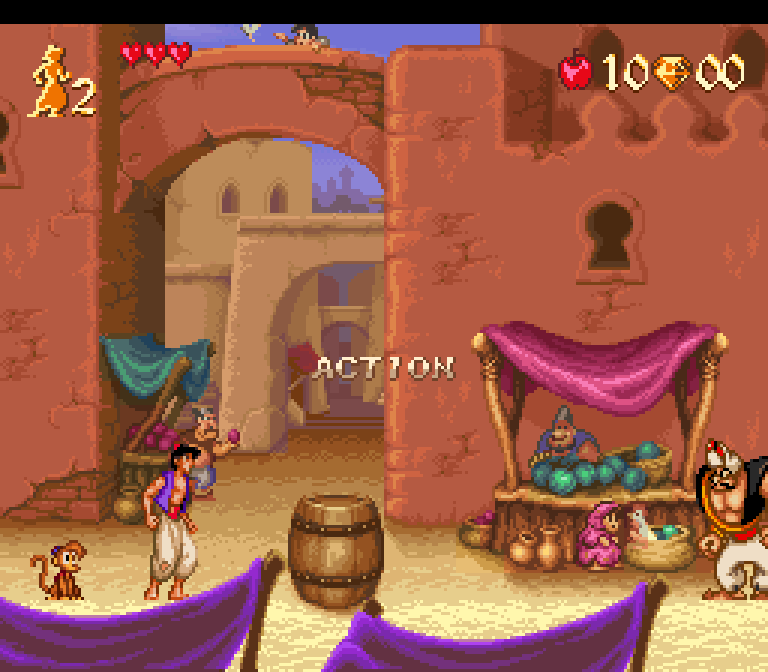
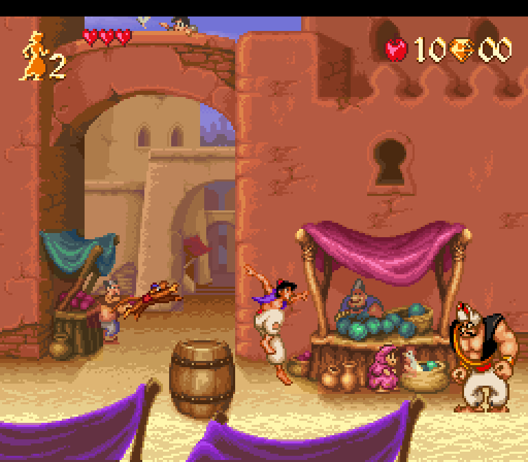
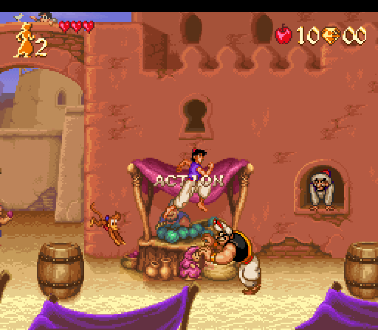
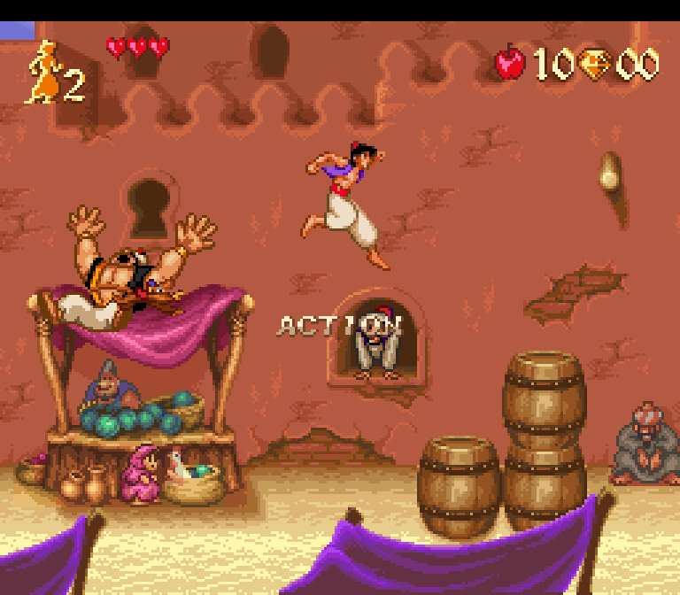

<p align="center">
  
</p>

<h1 align="center">AgrabahPort</h1>

<p align="center">
  <strong>Native PC Port of Disney's Aladdin (Super Nintendo, 1993)</strong><br>
  Built with static recompilation for Windows, Linux, and macOS.
</p>

<p align="center">
  <a href="https://github.com/testsenvergonha-sys/AgrabahPort/releases"></a>
  <a href="https://github.com/testsenvergonha-sys/AgrabahPort/releases/latest"></a>
  <a href="https://github.com/testsenvergonha-sys/AgrabahPort/stargazers"></a>
  <a href="https://github.com/testsenvergonha-sys/AgrabahPort/issues"></a>
</p>

<p align="center">
  <a href="https://recomplauncher.com"><picture><source media="(prefers-color-scheme: dark)" srcset="https://recomplauncher.com/assets/press/launcher/badge-light.svg"></picture></a>
</p>

<p align="center">
  <strong>English</strong> | <a href="README.pt-BR.md">Português (Brasil)</a> | <a href="CHANGELOG.md">Changelog</a>
</p>

---

## Overview

**AgrabahPort** is an open-source native PC port of Capcom's *Disney's Aladdin* (Super Nintendo, 1993), built using ahead-of-time (AOT) static recompilation. Rather than running through a traditional hardware emulator, the game's original 65816 assembly instructions and SPC700 audio subroutines are translated directly into portable C code and compiled as a standalone desktop binary.

The result is true native execution on modern systems with deterministic 60.0 FPS frame pacing, sub-millisecond input response, authentic CRT simulation shaders, and native gamepad support.

> **Legal Notice:** This project does not contain any copyrighted ROM data, artwork, audio, or game assets. Users must provide their own legally acquired copy of the original Super Nintendo cartridge dump.

---

## In-Game Screenshots

<p align="center">
  &nbsp;
  
</p>
<p align="center">
  &nbsp;
  
</p>

---

## Key Features

- **Ahead-of-Time Static Recompilation:** Runs as a compiled, native C/C++ executable on Windows, Linux, and macOS without emulation overhead.
- **Locked 60.0 FPS & Deterministic Frame Pacing:** Fully decoupled software delay and hardware VSync pipeline to ensure smooth motion across high-refresh displays.
- **Display Pipeline:** Authentic 4:3 CRT and 8:7 square-pixel presentation modes with integer scaling, clean pillarboxing, and post-processing shaders (*Sharp Pixel*, *CRT Scanlines*, *Warm Composite TV*).
- **No Scanline Sprite Limit:** Removes the original 32-sprites-per-scanline hardware bottleneck, eliminating sprite flickering during heavy action.
- **Zero-Config Gamepad Support:** Native SDL3 controller layer with hotplugging and automatic mapping for Xbox, PlayStation DualShock/DualSense, Nintendo Switch Pro, and standard DirectInput controllers.
- **Fully Portable Runtime:** Self-contained configuration (`config.ini`) and save directory (`saves/`). No system registry dependencies.
- **Quality of Life:** Real-time visual rewind buffer (`F12`), visual save-state gallery (`F11`), and an in-game configuration overlay (`ESC`).

---

## Quick Start

1. **Download:** Get the latest release archive from [Releases](https://github.com/testsenvergonha-sys/AgrabahPort/releases) or install directly via [RecompLauncher](https://recomplauncher.com).
2. **Provide your ROM:** Place a clean, headerless USA Super Nintendo ROM named `Aladdin.sfc` (or `.smc`) inside the game folder.
3. **Launch:** Run `AgrabahPort.exe`. The port verifies the ROM integrity and boots instantly.

*If no ROM is present on first launch, a file picker will prompt you to select your dumped cartridge.*

---

## ROM Compatibility & Integrity

To ensure timing and memory layout accuracy, AgrabahPort requires the original North American (USA) release:

| Property | Target Value |
|---|---|
| **Title** | *Disney's Aladdin* (USA) |
| **System** | Super Nintendo Entertainment System (SNES) |
| **Format** | Headerless `.sfc` (or standard `.smc`) |
| **File Size** | `1,310,720` bytes |
| **CRC-32** | `124D8E4D` |
| **SHA-256** | `AA768B8B00123717C8D49F2C6731CDBFD80AB6A54128BAE7594E93F45E38A19E` |

---

## Controls

Input bindings are fully customizable via `keybinds.ini` or in-game via the `ESC` settings menu.

| Action | Keyboard | Xbox Controller | PlayStation | Switch Pro |
|---|---|---|---|---|
| **Move / Crouch** | Arrow Keys / `W, A, S, D` | D-Pad / Left Stick | D-Pad / Left Stick | D-Pad / Left Stick |
| **Jump** | `Z` / `Space` | `A` Button | `Cross` (X) | `B` Button |
| **Sword Slash** | `X` | `X` Button | `Square` | `Y` Button |
| **Throw Apple** | `C` | `Y` Button | `Triangle` | `X` Button |
| **Dash / Run** | `Left Shift` | `B` Button | `Circle` | `A` Button |
| **Pause** | `Enter` | `Start` / `Menu` | `Options` | `+` (Plus) |
| **In-Game Menu** | `Escape` | `Back` + `LB` | `Share` + `L1` | `-` + `L` |
| **Fullscreen Toggle** | `Alt + Enter` | — | — | — |
| **Quick Save / Load** | `Shift + F1..F10` / `F1..F10` | — | — | — |
| **Save State Menu** | `F11` | — | — | — |
| **Real-time Rewind** | `F12` | `Back` + `R3` | `Share` + `R3` | `-` + `R3` |

---

## Building from Source

### Prerequisites
- C11 and C++17 compatible compiler (Clang 15+, GCC 12+, or MSVC 2022)
- CMake 3.20+ and Ninja build system
- Python 3.9+
- SDL3 and zlib development libraries

### Compilation
```bash
# Clone the repository with all submodules
git clone --recurse-submodules https://github.com/testsenvergonha-sys/AgrabahPort.git
cd AgrabahPort

# Place your validated ROM in the project directory
cp /path/to/Aladdin.sfc roms/Aladdin.sfc

# Generate static recompilation sources
bash tools/regen.sh

# Configure and compile
cmake -S . -B build -G Ninja -DCMAKE_BUILD_TYPE=Release
cmake --build build --config Release
```

The compiled binary will be placed at `build/AgrabahPort.exe`.

---

## License & Disclaimer

AgrabahPort is an independent, non-commercial fan project developed for educational and software preservation purposes under static recompilation principles.

- *Disney's Aladdin*, character names, and visual likenesses are registered trademarks and copyright of **Disney Enterprises, Inc.**
- Original Super Nintendo game code and design are copyright **Capcom Co., Ltd.**
- This project is neither affiliated with nor endorsed by Capcom, Disney, or Nintendo.
- No commercial distribution, licensing, or monetized access is permitted.