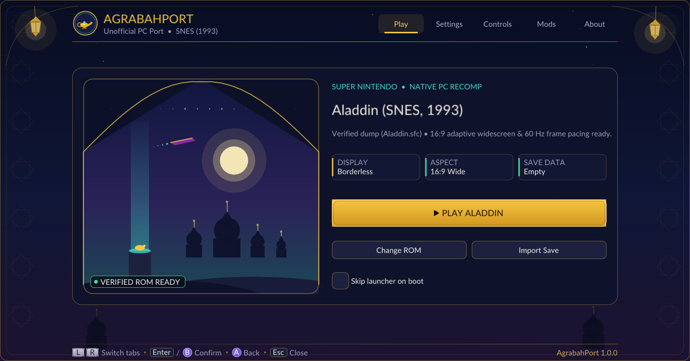
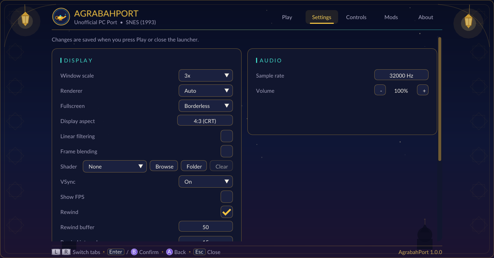

<p align="center">
  
</p>

<h1 align="center">AgrabahPort</h1>

<p align="center">
  <strong>Unofficial Native PC Port of Aladdin (Super Nintendo, 1993)</strong><br>
  Static recompilation for Windows, Linux, and macOS — <em>v1.0.0</em>
</p>

<p align="center">
  <a href="https://github.com/testsenvergonha-sys/AgrabahPort/releases"></a>
  <a href="https://github.com/testsenvergonha-sys/AgrabahPort/releases/latest"></a>
  <a href="https://github.com/testsenvergonha-sys/AgrabahPort/stargazers"></a>
  <a href="https://github.com/testsenvergonha-sys/AgrabahPort/issues"></a>
</p>

<p align="center">
  <a href="https://recomplauncher.com"><picture><source media="(prefers-color-scheme: dark)" srcset="https://recomplauncher.com/assets/press/launcher/badge-light.svg"></picture></a>
</p>

<p align="center">
  <strong>English</strong> | <a href="README.pt-BR.md">Português (Brasil)</a> | <a href="CHANGELOG.md">Changelog</a>
</p>

---

## 🖼️ Launcher Showcase

<p align="center">
  
  
</p>

<p align="center">
  <em>Left: Custom Palace Night Play tab with verified ROM badge and Super Nintendo controller hints. Right: Settings tab (Display, Aspect, Shaders, Show FPS, Audio &amp; Rewind).</em>
</p>

---

## 🌟 About AgrabahPort v1.0.0

**AgrabahPort** is an unofficial native PC recompilation of the 1993 Super Nintendo platformer *Aladdin*, powered by [snesrecomp](https://github.com/RetroPortingToolKit/snesrecomp) and [recomp-ui](https://github.com/mstan/recomp-ui).

Unlike emulators, AgrabahPort translates the original 65816 CPU instructions ahead-of-time into portable native C code paired with SDL3, OpenGL, and high-resolution frame pacing. The `v1.0.0` milestone graduates the project out of early test builds with an authorial **Palace Night** launcher, **Super Nintendo** navigation hints (`L`/`R`, `B`/`A`), **16:9 adaptive widescreen** across stages and bosses, smooth **Turbo (`Tab`)**, and a built-in **GitHub Releases Auto-Updater**.

> ⚖️ **Bring Your Own ROM — Zero Copyrighted Assets Included:** This repository and all public Setup Pack releases contain **no ROMs**, **no ROM-derived generated C code (`src/gen/`)**, and **no copyrighted game artwork or audio**. Public releases ship as a clean **Setup Host** (`-DSNESRECOMP_SETUP_HOST=ON`); you supply your own legal headerless US `.sfc` cartridge dump locally.

---

## ✨ What's in v1.0.0

- **Authorial Agrabah Launcher UI:** Custom Palace Night theme featuring hanging lanterns, geometric girih motifs, five organized tabs (**Play**, **Settings**, **Controls**, **Mods**, **About**), and visual **Super Nintendo** footer button badges (**`L`/`R`** tabs, **`Enter`/`B`** confirm, **`A`** back, **`Esc`** close).
- **Safe Built-In Auto-Updater:** Checks `testsenvergonha-sys/AgrabahPort` on GitHub Releases asynchronously at startup, prompts cleanly when a new version is published, automatically backs up `saves/` into `backups/pre_update_<version>/`, creates `AgrabahPort.exe.old`, and strictly preserves `saves/`, `mods/`, `states/`, `config.ini`, `keybinds.ini`, `rom.cfg`, `portable.txt`, and user ROMs.
- **Adaptive 16:9 Widescreen + Classic Ratios:** Dynamic wide viewport with per-stage BG2 world providers (Cave of Wonders, Carpet Escape, Lava wave, Jafar encounters) and clean pillarbox fallback on static/non-streaming screens, alongside authentic `4:3` and `8:7` options.
- **60.0 FPS Timing & Smooth Turbo (`Tab`):** Hybrid high-resolution wait clock locked to `60.0 Hz` plus decoupled VSync / 50 Hz presentation pacing gate during `Tab` fast-forward.
- **Sane Out-of-the-Box Defaults:** Starts in **Borderless Fullscreen** (`Fullscreen = 1`) with the title FPS overlay (`DisplayPerfInTitle = 0`) off by default — both toggleable live from **Settings**.
- **Shaders, Rewind & Save States:** *Sharp Pixel*, *CRT Soft Scanlines*, *Warm Composite TV*, *LCD Grid*, visual Save State browser (`F11`), Quick Save/Load (`Shift+F1..F10` / `F1..F10`), and real-time Rewind (`F12`).
- **100% Portable Mode:** Create a `portable.txt` beside the executable (or use portable builds) to keep `config.ini`, `keybinds.ini`, `saves/`, `mods/`, and `backups/` self-contained in one folder.

---

## ⚡ Quick Start (3 Steps)

1. **Download:** Grab the Setup Pack `.zip` for your OS from the [Releases](https://github.com/testsenvergonha-sys/AgrabahPort/releases) page (or install directly via [RecompLauncher](https://recomplauncher.com)).
2. **Provide your ROM:** Extract the archive and place your legal US headerless `.sfc` ROM next to the executable (or select it inside the launcher's first-run setup wizard).
3. **Play:** Run `AgrabahPort.exe` (or the Linux/macOS binary). On first run of a public Setup Pack, the wizard compiles your local executable cleanly from your own ROM and opens straight into the game.

---

## 🎮 Controls & Shortcuts

Controllers are auto-detected on plug-in (Super Nintendo USB pads, Xbox, PlayStation, Nintendo Switch Pro, and generic SDL gamepads).

| Action | Keyboard | SNES Layout | Xbox / XInput | PlayStation |
|---|---|---|---|---|
| **Move / Crouch** | Arrow Keys / `W A S D` | D-Pad | D-Pad / Left Stick | D-Pad / Left Stick |
| **Jump** | `Z` or `Space` | `B` | `A` | `Cross` |
| **Sword Slash** | `X` | `Y` | `X` | `Square` |
| **Throw Apple** | `C` | `X` | `Y` | `Triangle` |
| **Sprint / Run** | `Shift` | `A` | `B` | `Circle` |
| **Pause** | `Enter` | `Start` | `Menu / Start` | `Options` |
| **Turbo / Fast-Forward** | `Tab` | Mapped Assist | Mapped Assist | Mapped Assist |
| **Toggle Fullscreen** | `Alt + Enter` | — | — | — |
| **Launcher / Menu** | `ESC` | — | — | — |
| **Save State Browser / Rewind** | `F11` / `F12` | — | — | — |
| **Quick Save / Load** | `Shift+F1..F10` / `F1..F10` | — | — | — |

---

## ❓ FAQ

<details>
<summary><strong>Which ROM dump is verified?</strong></summary>

A legal, headerless USA Super Nintendo dump (`Aladdin.sfc`):
- **Size:** `1,310,720` bytes
- **CRC32:** `124d8e4d`
- **SHA-256:** `aa768b8b00123717c8d49f2c6731cdbfd80ab6a54128bae7594e93f45e38a19e`
</details>

<details>
<summary><strong>Will auto-updates overwrite my saves, configs, or mods?</strong></summary>

No. Before applying an update, the updater backs up `saves/` to `backups/pre_update_<version>/` and strips `saves/`, `backups/`, `mods/`, `states/`, `config.ini`, `config.local.ini`, `keybinds.ini`, `rom.cfg`, `portable.txt`, `AgrabahPort_window.cfg`, and any `.sfc`/`.smc`/`.srm`/`.sav` files from the extracted staging folder before copying files over.
</details>

<details>
<summary><strong>Where are logs and save files stored?</strong></summary>

Next to the executable inside `saves/` and `last_run_report.json` when `portable.txt` is present (or in your OS local app data directory otherwise). You can also open the **Live Log** directly inside the **About** tab of the launcher.
</details>

---

## 🛠️ Building from Source

<details>
<summary><strong>Local Developer Build &amp; Setup Host Instructions</strong></summary>

### Prerequisites
- C11 / C++17 toolchain (Clang / GCC / MinGW-w64), CMake 3.20+, Ninja, Python 3.9+, Rust toolchain, SDL3, zlib.

### Build with local ROM (for personal local testing only)
```bash
git clone --recurse-submodules https://github.com/testsenvergonha-sys/AgrabahPort.git
cd AgrabahPort

cp /path/to/Aladdin.sfc roms/Aladdin.sfc
bash tools/regen.sh

cmake -S . -B build -G Ninja -DCMAKE_BUILD_TYPE=Release
cmake --build build --target AladdinSNESRecomp
```

### Build public-safe Setup Host (no ROM-derived code compiled in)
```bash
cmake -S . -B build-setup -G Ninja -DCMAKE_BUILD_TYPE=Release -DSNESRECOMP_SETUP_HOST=ON
cmake --build build-setup --target AladdinSNESRecomp
```
</details>

---

## 📜 Legal Notice

AgrabahPort is an unofficial, non-commercial fan project and static recompilation engine. It is not affiliated with, endorsed by, or sponsored by Disney Enterprises, Inc., Capcom Co., Ltd., or Nintendo Co., Ltd. No ROM files, game assets, or copyrighted audiovisual content are distributed by this project; users must provide their own legally obtained cartridge dump.
