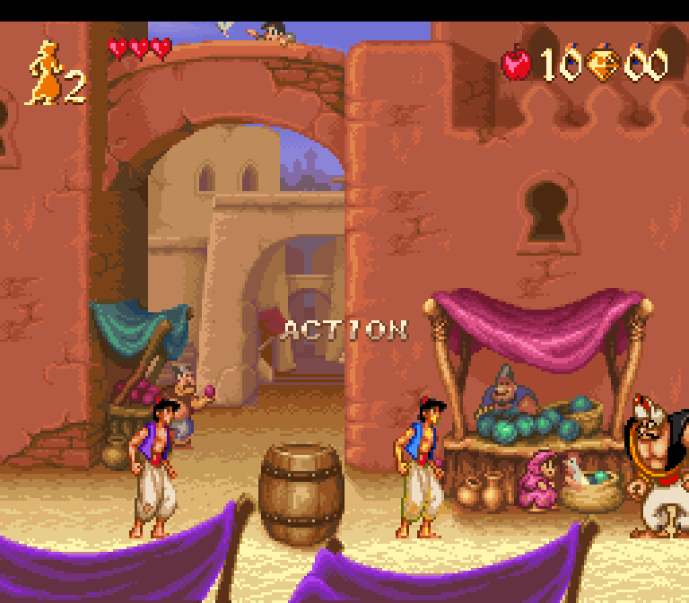
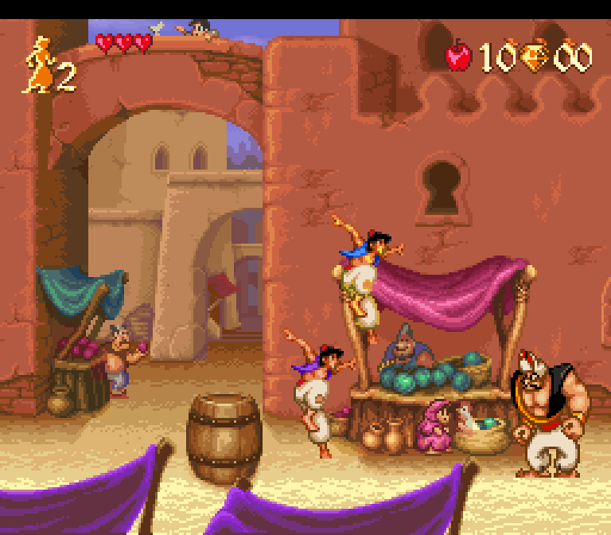
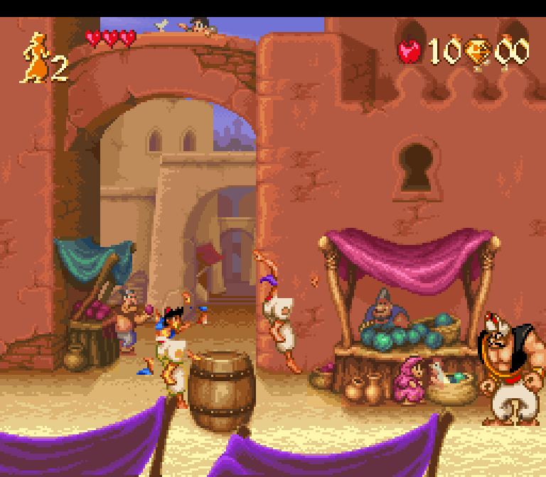
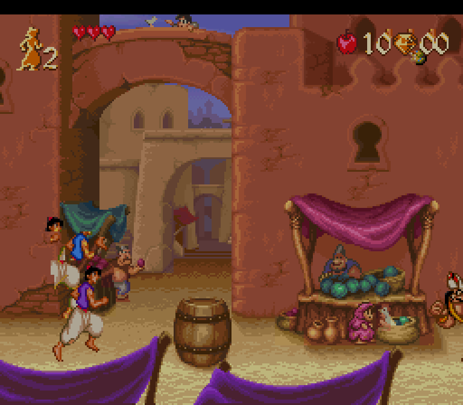

<p align="center">
  
</p>

<h1 align="center">AgrabahPort</h1>

<p align="center">
  <strong>Port Nativo para PC de Disney's Aladdin (Super Nintendo, 1993)</strong><br>
  Construído via recompilação estática para Windows, Linux e macOS.
</p>

<p align="center">
  <a href="https://github.com/testsenvergonha-sys/AgrabahPort/releases"></a>
  <a href="https://github.com/testsenvergonha-sys/AgrabahPort/releases/latest"></a>
  <a href="https://github.com/testsenvergonha-sys/AgrabahPort/stargazers"></a>
  <a href="https://github.com/testsenvergonha-sys/AgrabahPort/issues"></a>
</p>

<p align="center">
  <a href="https://recomplauncher.com"><picture><source media="(prefers-color-scheme: dark)" srcset="https://recomplauncher.com/assets/press/launcher/badge-light.svg"></picture></a>
</p>

<p align="center">
  <a href="README.md">English</a> | <strong>Português (Brasil)</strong> | <a href="CHANGELOG.md">Changelog</a>
</p>

---

## Visão Geral

O **AgrabahPort** é um port nativo e de código aberto para PC de *Disney's Aladdin* (Super Nintendo, 1993), desenvolvido originalmente pela Capcom, utilizando recompilação estática antecipada (*ahead-of-time recompilation*). Em vez de rodar sobre uma camada de emulação tradicional, as instruções 65816 do processador e as rotinas de áudio do chip SPC700 do SNES foram traduzidas diretamente para código C portável e compiladas como um executável nativo.

O resultado é uma execução direta no hardware hospedeiro com sincronização perfeita em **60.0 FPS cravados**, latência de entrada mínima, suporte completo a gamepads modernos e simulação fiel de telas CRT. Além disso, o AgrabahPort traz um modo cooperativo autêntico para **2 Jogadores simultâneos**, permitindo que o segundo jogador assuma o controle do Príncipe Ali com física, arremesso de maçãs e mecânicas de escalada independentes.

> **Aviso de Propriedade Intelectual:** Este projeto não inclui nem distribui arquivos de ROM protegidos por direitos autorais, artes visuais ou músicas originais. O usuário deve fornecer sua própria cópia legítima extraída do cartucho original do Super Nintendo.

---

## Capturas de Tela

<p align="center">
  &nbsp;
  
</p>
<p align="center">
  &nbsp;
  
</p>

---

## Recursos Principais

- **Execução Nativa em C/C++:** Desempenho nativo no Windows, Linux e macOS sem sobrecarga de máquina virtual ou soluções de atraso artificial (*run-ahead*).
- **Modo Co-op para 2 Jogadores:** O Jogador 2 entra na partida como o Príncipe Ali, com colisão independente com o cenário, munição própria de maçãs (`WRAM $0369`), contadores de vida separados e capacidade de escalar cordas e redes.
- **Taxa de Quadros Fixa em 60.0 FPS:** Pipeline de sincronização que desacopla atrasos de software do VSync de hardware, eliminando micro-engasgos mesmo em monitores de alta taxa de atualização.
- **Apresentação e Aspect Ratio Autêntico:** Proporções originais em 4:3 (padrão de TV de tubo) e 8:7 (pixels quadrados), com escala por números inteiros (*integer scaling*), bordas limpas (*pillarboxing*) e filtros visuais configuráveis (*Sharp Pixel*, *CRT Scanlines*, *Warm Composite TV*).
- **Sem Limite de Sprites por Linha:** Remoção da barreira de 32 sprites por linha horizontal do SNES, eliminando o piscar de personagens e itens na tela.
- **Suporte Amplo a Controles:** Camada de controle nativa via SDL3 com detecção imediata (*hotplug*) para gamepads Xbox, PlayStation (DualShock / DualSense), Nintendo Switch Pro e controles DirectInput genéricos.
- **Arquitetura 100% Portátil:** Configurações mantidas em `config.ini` e arquivos de salvamento em `saves/`, sem necessidade de gravação no registro do Windows ou diretórios ocultos do usuário.
- **Recursos de Conforto:** Rebobinamento visual em tempo real (`F12`), gerenciador gráfico de save-states (`F11`) e menu de opções acessível a qualquer momento (`ESC`).

---

## Como Jogar

1. **Download:** Baixe o pacote mais recente na seção de [Releases](https://github.com/testsenvergonha-sys/AgrabahPort/releases) ou instale diretamente pelo [RecompLauncher](https://recomplauncher.com).
2. **Forneça a sua ROM:** Coloque o arquivo do jogo americano do Super Nintendo (`Aladdin.sfc` ou `.smc`, sem cabeçalho) dentro da pasta principal do AgrabahPort.
3. **Inicie o Jogo:** Abra o executável `AgrabahPort.exe`. O jogo identificará a ROM e iniciará imediatamente.

*Caso o arquivo da ROM não esteja presente no diretório na primeira execução, uma caixa de seleção solicitará a localização do arquivo.*

---

## Requisitos e Integridade da ROM

Para garantir precisão de endereçamento de memória e fidelidade de tempo, o AgrabahPort utiliza como referência o cartucho oficial norte-americano (USA):

| Propriedade | Valor Esperado |
|---|---|
| **Jogo** | *Disney's Aladdin* (Versão Americana / USA) |
| **Plataforma** | Super Nintendo Entertainment System (SNES) |
| **Formato** | Arquivo sem cabeçalho `.sfc` (ou formato padrão `.smc`) |
| **Tamanho** | `1.310.720` bytes |
| **CRC-32** | `124D8E4D` |
| **SHA-256** | `AA768B8B00123717C8D49F2C6731CDBFD80AB6A54128BAE7594E93F45E38A19E` |

---

## Controles Padrão

O mapeamento de botões pode ser personalizado pelo arquivo `keybinds.ini` ou diretamente no menu de pausa acessado via tecla `ESC`.

| Ação | Teclado (Jogador 1) | Controle Xbox | Controle PlayStation | Switch Pro |
|---|---|---|---|---|
| **Mover / Agachar** | Setas / `W, A, S, D` | D-Pad / Analógico Esquerdo | D-Pad / Analógico Esquerdo | D-Pad / Analógico Esquerdo |
| **Pular** | `Z` / `Espaço` | Botão `A` | Botão `X` (Cross) | Botão `B` |
| **Golpe de Espada** | `X` | Botão `X` | Botão `Quadrado` | Botão `Y` |
| **Arremessar Maçã** | `C` | Botão `Y` | Botão `Triângulo` | Botão `X` |
| **Correr** | `Shift Esquerdo` | Botão `B` | Botão `Círculo` | Botão `A` |
| **Pausar** | `Enter` | `Start` / `Menu` | `Options` | `+` (Mais) |
| **Menu de Configuração** | `ESC` | `Back` + `LB` | `Share` + `L1` | `-` + `L` |
| **Alternar Tela Cheia** | `Alt + Enter` | — | — | — |
| **Salvar / Carregar Rápido**| `Shift + F1..F10` / `F1..F10` | — | — | — |
| **Gerenciador de Saves** | `F11` | — | — | — |
| **Rebobinar Partida** | `F12` | `Back` + `R3` | `Share` + `R3` | `-` + `R3` |

*Para jogar em modo cooperativo local, conecte um segundo controle ao computador (`SourceP2 = 2` no `config.ini`).*

---

## Compilação a partir do Código-Fonte

### Requisitos de Ambiente
- Compilador C11 e C++17 (Clang 15+, GCC 12+ ou MSVC 2022)
- CMake 3.20+ e gerador de compilação Ninja
- Python 3.9+
- Bibliotecas de desenvolvimento de SDL3 e zlib

### Processo de Compilação
```bash
# Clone o repositório com todos os submódulos necessários
git clone --recurse-submodules https://github.com/testsenvergonha-sys/AgrabahPort.git
cd AgrabahPort

# Copie a sua ROM validada para o diretório indicado
cp /caminho/para/Aladdin.sfc roms/Aladdin.sfc

# Gere as rotinas C a partir da recompilação estática
bash tools/regen.sh

# Configure e compile o projeto
cmake -S . -B build -G Ninja -DCMAKE_BUILD_TYPE=Release
cmake --build build --config Release
```

O binário final será gerado em `build/AgrabahPort.exe`.

---

## Termos e Isenção de Responsabilidade

O AgrabahPort é uma iniciativa independente e sem fins lucrativos desenvolvida com finalidades exclusivas de pesquisa em engenharia reversa, educação e preservação de software.

- *Disney's Aladdin*, nomes de personagens e identidade visual associada são marcas registradas e direitos reservados de **Disney Enterprises, Inc.**
- Todo o código original e design do jogo para Super Nintendo são de propriedade de **Capcom Co., Ltd.**
- Este projeto não possui afiliação, vínculo ou endosso de Capcom, Disney ou Nintendo.
- Não é permitida qualquer forma de comercialização ou monetização deste software.